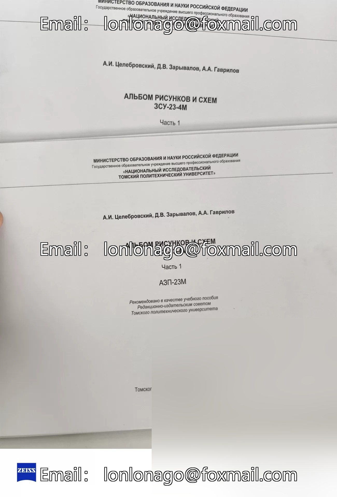
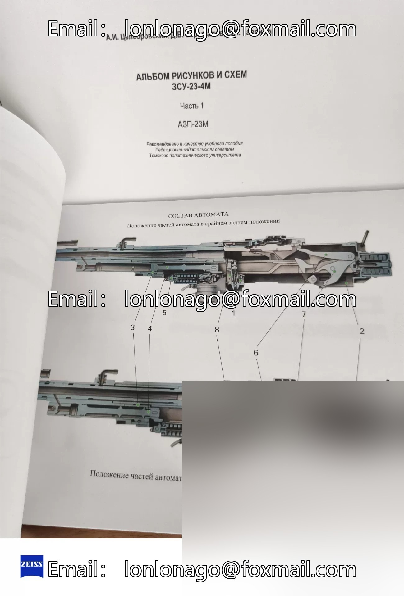
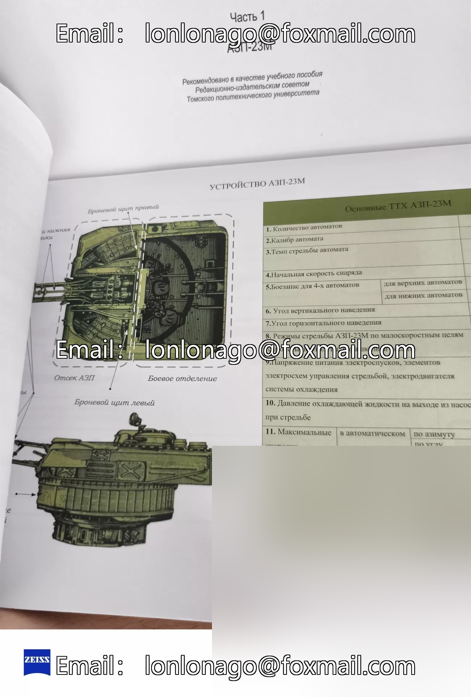
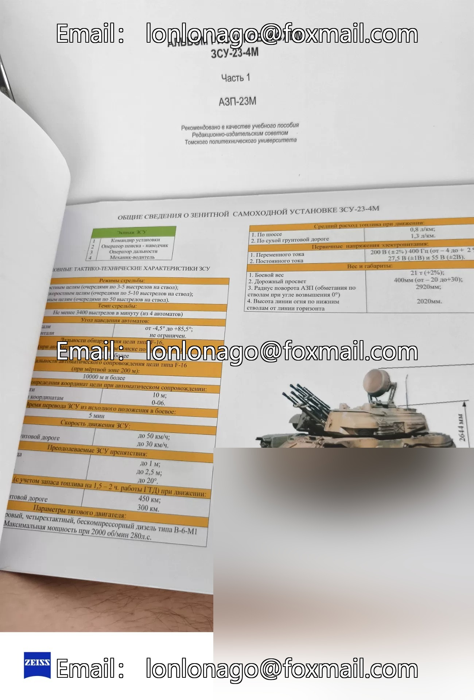

# ZSU-23-4"Shilka" (Shillek River)

## Body

ZSU-23-4 "Shilka" (Shilka River) - Technical document, Russian paper original version. Rare!

This is a Russian paper original technical document concerning the Shi Lake River area, including references to authors and identifiers.

<!-- AI_ENRICHED -->

## Images

## Payment

Here is a pay link on Stripe ( https://buy.stripe.com/3cs8yP7sY87d0vu9AB ). Please contact me lonlonago@foxmail.com after funding $89, and I will send you a complete data files , thank you!

